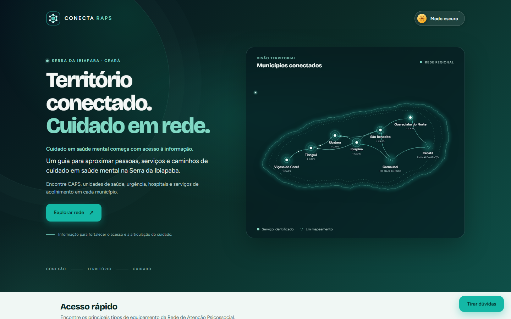
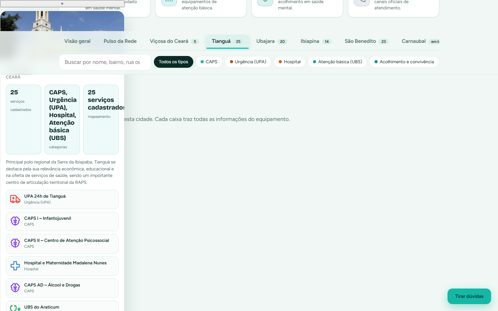

<div align="center">

# 🌿 CONECTA RAPS

### Território, cuidado e articulação em rede na Atenção Psicossocial

**Guia interativo dos serviços de saúde mental da Serra da Ibiapaba — Ceará**

[](https://vitejs.dev)
[](https://www.typescriptlang.org)
[](LICENSE)
[](https://github.com/Rafael-Azize9/conecta-raps-FACIBI)

</div>

---

<p align="center">
  
</p>

## 📖 Sobre o projeto

O **Conecta RAPS** é uma plataforma web que reúne, em um só lugar, os equipamentos da **Rede de Atenção Psicossocial (RAPS)** de 8 municípios da Serra da Ibiapaba. O objetivo é facilitar o acesso da população aos caminhos de cuidado em saúde mental: **onde procurar, o que existe na sua cidade e como chegar lá**.

O sistema foi pensado para responder, de forma rápida e visual:

- **Onde** ficam os CAPS, UBS, urgências, hospitais e serviços de acolhimento da minha cidade?
- **Quais** serviços já estão mapeados e quais ainda estão em mapeamento?
- **Como** a rede se conecta territorialmente entre os municípios?

> ⚕️ *Projeto acadêmico — Psicologia, 8º semestre, FACIBI, 2026.2*

---

## ✨ Funcionalidades

| Recurso | Descrição |
| :--- | :--- |
| 🗺️ **Mapa territorial interativo** | Rede de municípios conectados; clique em um nó para abrir o resumo da cidade |
| 🏙️ **Card flutuante por município** | Imagem da cidade, nº de serviços, categorias, situação do mapeamento e lista de estabelecimentos |
| 🔍 **Busca global** | Filtra por nome, bairro, rua, tipo de serviço ou município |
| 🏷️ **Filtros por categoria** | CAPS · UBS · Urgência · Hospital · Acolhimento |
| 🏘️ **Aba por cidade** | Cada município tem sua própria aba com todos os equipamentos em detalhes |
| 🖼️ **Exploração territorial** | Painel por cidade com arte local, mapa ilustrativo, filtros e lista de equipamentos |
| 🌓 **Tema claro / escuro** | Alternância com persistência (localStorage) e respeito ao sistema |
| 💬 **Assistente da rede** | Painel de dúvidas com respostas a partir da própria base de dados |
| 📱 **100% responsivo** | Layout adaptado de desktop a mobile |
| ♿ **Acessibilidade** | Navegação por teclado nos nós do mapa, labels ARIA e foco visível |

---

## 🏘️ Municípios mapeados

| Município | Serviços | Situação |
| :--- | ---: | :--- |
| Tianguá | 25 | ✅ Mapeado |
| São Benedito | 23 | ✅ Mapeado |
| Ubajara | 20 | ✅ Mapeado |
| Ibiapina | 14 | ✅ Mapeado |
| Viçosa do Ceará | 5 | ✅ Mapeado |
| Guaraciaba do Norte | 1 | 🔄 Em mapeamento |
| Carnaubal | 0 | 🔄 Em mapeamento |
| Croatá | 0 | 🔄 Em mapeamento |
| **Total** | **88** | |

> Os números refletem a base de dados cadastrada no projeto (`src/data.ts`).

---

<p align="center">
  
</p>

---

## 🛠️ Stack técnica

| Camada | Tecnologia |
| :--- | :--- |
| **Build** | [Vite 5](https://vitejs.dev) |
| **Linguagem** | TypeScript (modo `// @ts-nocheck`, sem framework) |
| **Estilo** | CSS puro com Design System (variáveis CSS + `color-mix`) |
| **Mapa** | SVG gerado por código (sem dependência de tile server) |
| **Ícones** | SVG inline |
| **Testes** | Playwright |
| **Fontes** | Bricolage Grotesque + Figtree (Google Fonts) |

**Sem frameworks, sem backend, sem banco de dados.** Toda a base de dados vive em um único módulo TypeScript — o site funciona como um *single page app* estático, podendo ser hospedado em qualquer servidor de arquivos (GitHub Pages, Netlify, Vercel…).

---

## 📁 Estrutura do projeto

```
conecta-raps-FACIBI/
├── index.html              # Estrutura única da página (SPA)
├── public/
│   ├── favicon.svg         # Favicon vetorial (marca de rede)
│   ├── favicon-32x32.png
│   ├── apple-touch-icon.png
│   └── icon-*.png
├── src/
│   ├── main.ts             # Toda a lógica: navegação, mapa, filtros, tema, assistente
│   ├── data.ts             # Base de dados: 88 serviços, 8 municípios, artes e textos
│   └── style.css           # Design system e estilos completos
├── docs/                   # Screenshots usados no README
├── vite.config.ts
└── package.json
```

### Como os dados funcionam

Em `src/data.ts` estão centralizados:

- **`U`** — array com todos os serviços (cidade, tipo, endereço, telefone, horário, público, demandas…)
- **`CITIES`** / **`CITY`** — lista de municípios e metadados de cada um
- **`ART`** / **`TEX`** — artes vetoriais e imagens de cada cidade
- **`T`**, **`IC`**, **`SI`** — categorias, cores e ícones

Alterar um telefone ou adicionar um serviço é editar **um objeto** nesse arquivo — nada de consultas a APIs.

---

## 🚀 Como rodar

**Requisitos:** [Node.js](https://nodejs.org) 18+

```bash
# 1. Clone o repositório
git clone https://github.com/Rafael-Azize9/conecta-raps-FACIBI.git
cd conecta-raps-FACIBI

# 2. Instale as dependências
npm install

# 3. Inicie o modo desenvolvimento
npm run dev
```

Acesse **http://localhost:5173** 🎉

### Outros comandos

```bash
npm run build      # Gera a versão de produção em dist/
npm run preview    # Visualiza o build de produção localmente
npm run typecheck  # Verifica os tipos do TypeScript
```

---

## 🧭 Navegação no site

1. **Hero** — apresentação e mapa territorial da rede
2. **Acesso rápido** — atalhos para CAPS, unidades de saúde, acolhimento e contatos
3. **Barra de busca** — abas por município + filtro por categoria + busca por texto
4. **Escolha uma cidade** — cards com o resumo de cada município
5. **Assistente** — botão *Tirar dúvidas* no canto inferior direito

---

## 🎨 Identidade visual

A identidade usa a paleta **verde petróleo + turquesa**, inspirada na Serra da Ibiapaba:

| Elemento | Cor |
| :--- | :--- |
| Primária (CAPS, botões) | `#14b8a6` / `#2DD4BF` |
| Fundo claro | `#f0f7f4` |
| Fundo escuro | `#0B181D` |
| Destaques (urgência) | `#ea580c` / `#E7B73C` |

A marca é uma **rede de nós conectados** — seis equipamentos em torno de um núcleo central, representando a articulação da RAPS entre os municípios.

---

## ⚠️ Aviso importante

Este é um **guia informativo** e não substitui os canais oficiais de atendimento. Confirme endereço, telefone e horário de funcionamento diretamente com o equipamento antes de se deslocar.

**Em caso de crise ou urgência em saúde mental, procure o CAPS mais próximo ou ligue:**

- **SAMU** — 192
- **CVV** — 188 (24 horas)
- **Disque Saúde** — 136

---

## 📚 Contexto acadêmico

Desenvolvido como projeto de disciplina do curso de **Psicologia** — **8º semestre** da **FACIBI** (Faculdade de Ciências do Interior do Bahia), semestre **2026.2**.

---

## 📄 Licença

Distribuído sob a licença **MIT**. Veja o arquivo [LICENSE](LICENSE) para mais detalhes.

---

<div align="center">
  <sub>Feito com 💚 para a Serra da Ibiapaba</sub>
</div>
